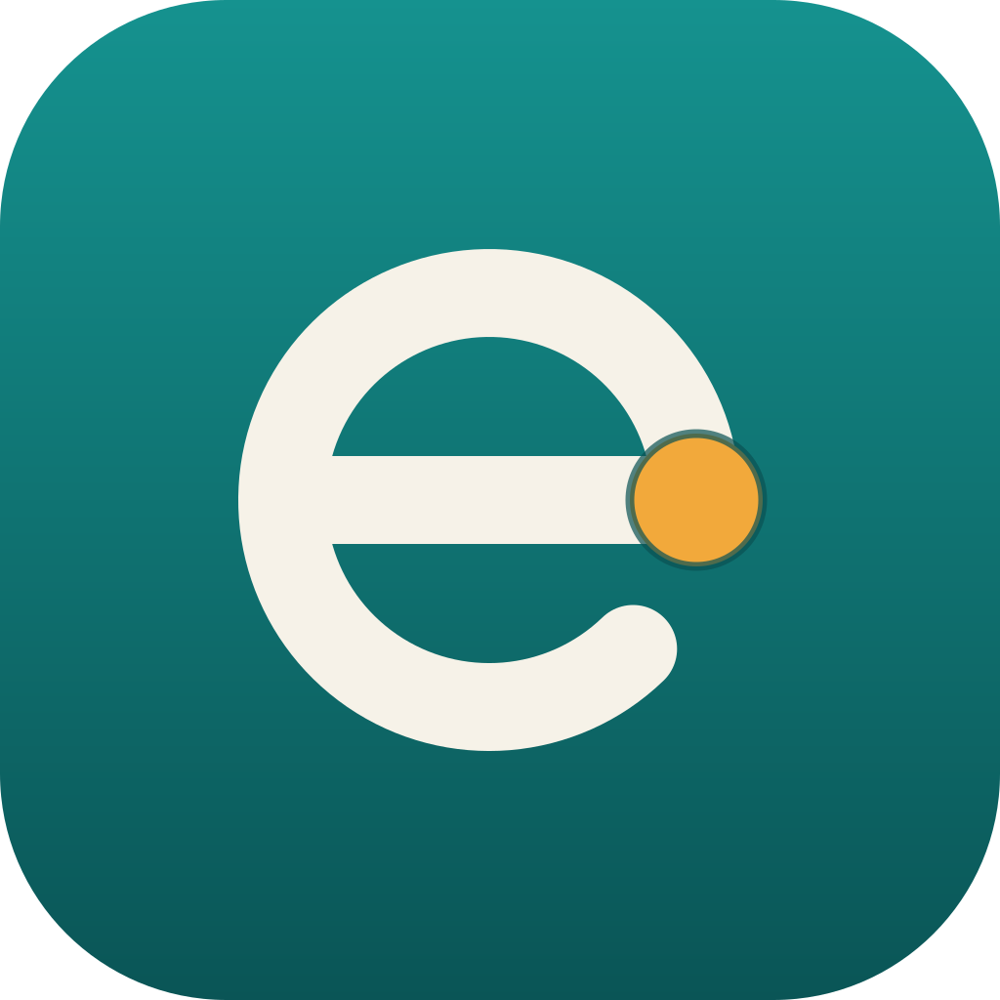

<p align="center"></p>

# EasySwitch

把用户授权的模型来源用进熟悉的 agent，通过明确开启的增强会话工作，尽量保留日常原生配置。

当前为 **v0.0.1 demo**：Node 核心与网页控制台可在 Linux 开发测试；Swift 菜单栏和原生钥匙串属于 macOS。支持清单中的“实现”“文档支持”“模拟测试”“真实客户端验证”不是同一个状态，请查看控制台能力矩阵和 [验证范围](docs/testing.md)。

## 工作方式

- 每次启动使用参数、环境变量或私有目录；不直接改写用户日常 agent 配置
- 入站协议由 agent 决定，出站协议由来源和模型能力决定。同协议优先直通，跨协议按需转换，不把 Chat 当统一中间协议
- 原生 Claude 与外接来源的鉴权分开；外接请求只使用选中来源的凭据
- 本地访问令牌需实际签发，不能仅靠字符串前缀取得权限。普通交互窗口关闭尚不能保证自动撤销，可手动撤销或等待到期；托管后台任务结束会撤销。会话停止、到期和重启行为见 [鉴权与预算说明](docs/gateway-budget-keychain.md)
- 真实调用可能使用厂商额度或产生费用。模型探测、登录及真实 agent 端到端测试均不属于“纯本地测试”

控制台提供暖纸色/青绿色样式、Agent 页快捷派活、菜单栏面板订阅开关，以及启动器的全模型菜单配置；真实宿主菜单验收仍单独列明。

## 当前功能与证据

| 部分 | 当前实现及边界 |
|---|---|
| 网关 | Responses、Chat Completions、Anthropic Messages、Gemini 四种入口；来源/模型级协议选择、同协议 JSON/SSE 与错误响应透传、跨协议转换。详见 [协议说明](docs/outbound-adapters.md) |
| 来源与模型 | 预设、自定义来源、Key 轮换、模型池故障切换、能力探测；开始输出后不重放生成。预设存在不代表真实账号已验证 |
| 启动器与 MCP | 多 agent 的每次启动配置、后台任务、MCP 互调、任务分派；新增配置与本地桥接的验证边界见 [agent 配置与限制](docs/agent-gaps-validation.md) |
| 控制台 | agent、来源、会话、用量、任务及能力信息；协议设置、手动配置向导、本地访问凭据和预算控件按实际能力显示，不能配置的产品明确说明 |
| 计费与预算 | 按调用时的价格估算；未知价格不显示为零，订阅不冒充逐次 API 账单。日/月阈值可提醒或阻止后续请求，但不是供应商账单硬上限，不能消除在途请求和未知价格误差；启用停止预算时阻止未完整计费的来源探测 |
| 订阅支持 | 官方 API Key 接入、官方 agent 接口与原生登录复用分别标注。所有订阅来源默认关闭；原生登录复用、条款与真实账号验收不因代码存在而获得确认，只用假服务测过的会明说。其他未支持的来源会按能力边界拒绝。 |
| Claude Desktop | 实验性隔离后端、UI 和模拟测试存在，**真实启动默认拒绝**。官方 Linux 2.19675.1 签名包忽略旧隔离变量，当前云环境网络隔离预检也受限；未通过真实应用验收。见 [证据与限制](docs/claude-desktop-isolation.md) |
| ChatGPT Desktop | 历史原生/外接网关代码与模型目录存在；当前原生 WebSocket 路径明确拒绝，因为尚不能保证逐帧预算和会话失效处理；不能用旧客户端测试替代新鉴权路径验收 |
| 菜单栏与密钥 | Swift 菜单栏；密钥桥改用 Security.framework helper，密钥经 stdin 传入而非命令参数。Linux 测试不证明 macOS 编译、钥匙串访问或菜单栏行为 |

## 开发运行

需要 Node ≥ 22.18。运行时保持零 npm 依赖；开发依赖按锁文件安装：

```bash
npm ci --ignore-scripts
npm run typecheck
npm run test:local
node core/src/main.ts
```

Linux仅做无真实凭据的临时演示时，可用 `EASYSWITCH_SECRETS=memory node core/src/main.ts`；内存Key不会持久保存，也不替代macOS钥匙串验收。

本地控制台默认位于 `http://127.0.0.1:18765`。不要把控制台或网关暴露到公网；Host 检查、自定义控制台头和网关令牌并不构成完整的多用户远程服务安全方案。

macOS 原生组件需要 Xcode Command Line Tools；先按 [钥匙串说明](docs/native-keychain.md) 配置稳定签名身份，再构建和完成平台验收：

```bash
sh scripts/build-keychain.sh
./scripts/build-menubar.sh
```

不要把源码包含构建脚本当成已经完成系统安装。

## 安全测试入口

`npm run test:local` 使用临时 HOME、内存凭据、显式测试白名单及本地网络限制；普通测试禁止子进程，桌面模拟测试只允许经过核对的固定假程序。新增测试必须先审查再加入白名单。

`npm test` 是完整测试入口，包含可能调用真实 agent 的用例。只有明确允许真实客户端及其潜在账户用量时才运行，不能用它替代零模型调用的测试命令。

可重复执行的本地测试与真实客户端验收分开记录，详见 [测试说明](docs/testing.md)。不要把历史结果套用于新的代码或客户端版本。

## 仍需注意

- 跨协议转换存在能力差异；不支持的原生工具和无法无损转换的内容应拒绝或明确记录损失。思考和文本按内容块即时转换；需要完整对象的工具参数等到该块结束，详情见协议说明
- 签名/续传元数据需要客户端保留；本地假服务不能证明所有厂商真实兼容
- 官方 MiMo API、Token Plan 与未公开接口不是同一来源；未经文档支持的 Free 路径不开放真实使用。见 [MiMo](docs/mimo-sources.md)
- Vertex服务账号Chat、手动令牌Gemini与Express Key Gemini的地址和鉴权不同；真实云项目、密钥及计费请求需另行授权与验证。见 [Vertex](docs/vertex.md)
- DeepSeek/Kimi 推理设置按具体模型处理，不能套用统一档位。见 [推理能力](docs/provider-thinking.md)
- macOS Keychain、真实 agent、Claude Desktop 及本机原生配置隔离仍有独立验收要求

## 来源与差异化

EasySwitch 的差异必须落在隔离、回退、鉴权分离和可核验的功能支持上，不能只靠名称或配色。保留通用交互的理由是降低使用成本。

本文描述功能与验证边界，不是发布就绪声明。分发前仍需核实许可证、图标及凭据处理，不能仅凭测试通过认定可以公开发布。

## 许可证

[Apache-2.0](LICENSE)
